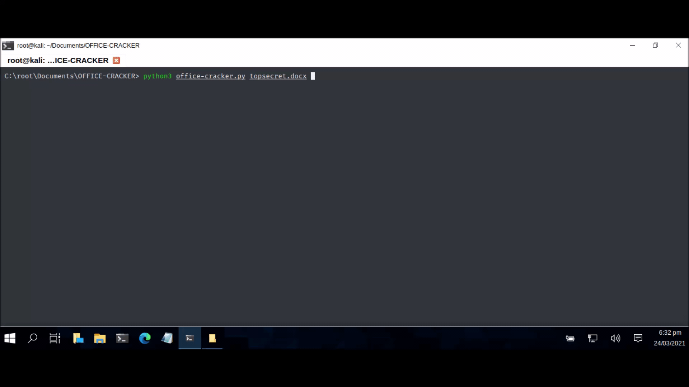

# MICROSOFT OFFICE CRACKER

*A Python script for testing the security of encrypted Microsoft Office documents.*

  

---

## PROJECT INFORMATION

| LANGUAGE | FILENAME | MD5 HASH | VERSION |
|---|---|---|---|
| Python 3 | `office-cracker.py` | `84459ebe7ff85c3c667069e80ccce350` | 3.0 |
| DOC | `topsecret.doc` | `deabfc23261259cec48f226ef154df51` | |
| XLSX | `topsecret.xlsx` | `8c977a4286601341728f121fc9a02752` | |

---

## OVERVIEW

A Python-based tool exploring Microsoft Office document security and password protection. The script features a menu-driven interface and is intended for authorised security testing and educational use.

Use only on files you own or have explicit permission to assess.

---

## CONSOLE DISPLAY

---

## LEGAL DISCLAIMER

### COMPUTER MISUSE ACT 1990 — SECTION 3A

This software is provided for legitimate security testing, educational purposes, and authorised assessment only.

Users are responsible for ensuring that their use of this software complies with all applicable laws and regulations. Unauthorised access to computer systems or data may constitute a criminal offence under the Computer Misuse Act 1990.

The developer accepts no responsibility for misuse of this software.

---

## SUPPORT THE PROJECT

Found this project useful, or would like to support the developer with a coffee?

Donations are appreciated:

[Donate via PayPal](https://paypal.me/TerenceBroadbent)
